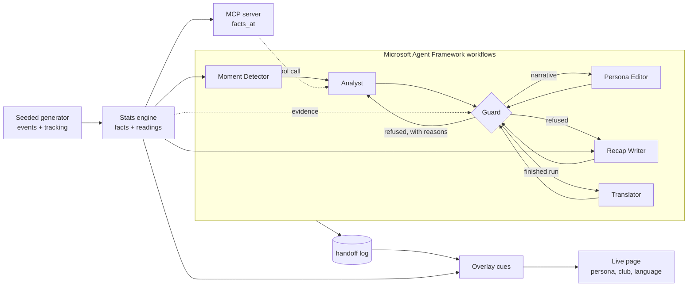

# Footnote

**Every line on screen has a footnote with its evidence.**

A language model in a live broadcast can invent a number, or a judgement the match does not
support, and on air one wrong number is a correction. Footnote lets agents write the words and
keeps the facts out of their hands. A deterministic stats engine supplies every number and every
judgement phrase. A deterministic Guard checks every draft against the engine before it reaches
the screen, and a draft it refuses goes back to its agent with the reasons.

From a synthetic football match Footnote makes explainable, personalized on-screen intelligence:
overlay cards, a narrative for each key moment, a recap at full time, an Analyst and a Fan
persona, and English or Slovak.

Entry for the Microsoft "Inside the Game" hackathon in the category **Best Multi-Agent System**
(Best Multi-Agent Orchestration). All clubs, players and matches are fictional.

- **Live demo:** https://ca-matchlens.niceglacier-670016e8.swedencentral.azurecontainerapps.io/
- The Python package and its command line are called `matchlens`.

## What it does

One pipeline with the five stages of the challenge:

| Stage | What Footnote does |
|---|---|
| Ingest | A seeded generator writes a whole match: its metadata, its events (passes, shots, clearances, tackles, interceptions, recoveries, pressure, fouls, saves, goals) and 10 Hz tracking. The server replays it live as Server-Sent Events. |
| Interpret | A deterministic stats engine computes possession and its changes, pass quality, ball and shot speed, distance, pressing, momentum and control vs chaos. Each number is a fact with the event or frame ids it comes from. Readings turn numbers into fixed judgement phrases, such as "take the lead" or "on top". |
| Explain | Agents on Microsoft Agent Framework write a narrative for each key moment and a recap at full time, each behind the Guard. |
| Render | Timed, machine-readable overlay cues stream next to a 2D pitch: lower thirds and a rail of cards, each with its evidence. |
| Personalize | An Analyst or a Fan persona, a favourite club and English or Slovak: different experiences of the same verified facts. |

**What the tracking is, and is not.** The matches come from generator v2
(`src/matchlens/generator_v2.py`). Its decision layer, v1's, chooses who acts, how and with what
outcome, tuned to the numbers of a match: passes, pass accuracy, shots and goals. A movement layer
moves all 22 players every 100 ms toward targets, each under his own limits on speed and
acceleration. The targets are a slot of the club's formation in and out of possession (four
clubs, four formations, each with its own line height, press and width), pressing, marking, runs
and the keeper's position, and every restart is laid out by the Laws of the Game. The events
come from these simulated positions, and the 10 Hz tracking is these steps, not points drawn
between events. It is not real data and not a learned model: there are no offsides, cards,
substitutions or dribbles, and the ball moves in two dimensions. Generator v1
(`src/matchlens/generator.py`) stays in the code.

## Architecture



The Moment Detector and the Guard are code. The Analyst, the Persona Editor, the Recap Writer and
the Translator are Claude models on Microsoft Foundry. Three workflows share these executors: one
explains the key moments, one writes the recap at full time and one translates a finished run.

## The agents

| Agent | Kind | Job | When it fails |
|---|---|---|---|
| Moment Detector | code | Finds the key moments of the match so far: goals, saves and shots off the woodwork. Looks up each moment's evidence in the engine. | A moment whose facts are not the engine's stops the run before the first model call. |
| Analyst | model | Writes a caption for a moment and the claims it is made of. Reads the facts with the MCP server's `facts_at` tool (with `--mcp`; otherwise they are in its prompt). Computes nothing. | A refused draft goes back with the Guard's reasons, at most twice. Then the moment gets a stats-only card. |
| Guard | code | Judges every draft against the engine, never with a model. Its reasons are machine-readable codes, such as `phrase_not_cited`. | A stats-only card that does not pass it stops the run: that is a bug, not a moment to skip. |
| Persona Editor | model | Rewrites a narrative that passed for the Fan persona. | A rendition that fails twice falls back to the narrative. |
| Recap Writer | model | Writes the recap at full time from the whole match's facts. | A recap that fails its attempts falls back to the engine's own recap. |
| Translator | model | Translates every passed text into Slovak and keeps each numeral and name as it is. | A translation that fails twice falls back to English. |

**Shared state.** The agents hand each other one case per key moment (`MomentCase` in
`src/matchlens/explain/state.py`). A case can end as a narrative only when its last draft passed the
Guard, a rule checked whenever a case is built, and in the workflow only the Guard's step marks a
draft as passed. Before the server shows any logged text, the Guard judges it again, so a
hand-edited log gets no further than a model's reply. A single agent that writes and judges its own
text could not give that guarantee.

**What the Guard checks.** A draft passes only when:

- every number in digits is the display of a fact that its claim cites, and numbers in words
  are refused by a list (`two`, `brace`, `first goal`);
- every claim names evidence that exists and belongs to a fact it cites or to the moment itself:
  event ids, or frame ids;
- every phrase of the engine's judgement vocabulary stands in a claim that cites the matching
  reading, and the listed words that judge without one, such as `lead`, `beat` or `dominate`,
  are refused;
- every capitalized name inside a sentence is a player or club of the match.

It checks words and numbers, not what a sentence means. Its known limits are listed in the
docstring of `src/matchlens/explain/guard.py`.

**How the agents recover.** Every handoff between agents is logged as a JSON line, so a run can be
replayed, audited and served without new model calls. A call that brings no draft counts as a
failed attempt. A circuit breaker opens after 3 calls in a row that brought no answer at all.
Each command (`explain`, `recap`, `translate`) has one budget, `--max-calls`, for the model
requests of all the agents it runs, and the SDK retries nothing, so the budget sees every
request it allows, and no request passes the cap. The demo runs show the loop three times, each
text passing at its second attempt: the Guard refused a narrative whose claim said "are on top"
without naming the club of the reading it cited (`phrase_not_cited`,
`demo/runs/m1/handoffs.jsonl`), a fan rendition with the judgement word "lead"
(`judgement_word`, `demo/runs/m0/handoffs.jsonl`) and a Slovak translation that judged the
possession without its reading (`phrase_not_cited`, `demo/runs/m0/translate.sk.jsonl`).

## Measured results

The demo's runs on Microsoft Foundry, 28 October 2026: Claude Sonnet 5.5 on generator v2's three
matches with 35 key moments, the Analyst reading the facts over MCP:

| What | Result |
|---|---|
| Narratives | 34 of 35 passed the Guard at the first attempt, 35 of 35 at the second |
| Fan renditions | 35 of 35 passed; 35 of 35 differ from their narrative |
| Recaps and fan recaps | 3 of 3 each passed |
| Slovak translations | 76 of 76 passed; one passed at its second attempt |
| Time per narrative, its attempts and the MCP call | 4.73 s median, 9.24 s at the 95th percentile |
| Generator v1's matches, 23 to 25 October, Sonnet 5.5 and Haiku 5.5 | 28 of 28 narratives each passed at the first attempt; the Sonnet runs are in `demo/runs-v1/` |

And around them:

| What | Result |
|---|---|
| Stream to screen, local, 23 October: an event's overlay card in the browser | 18.7 ms median, 68.0 ms at the 95th percentile |
| Azure cost of the project, 1 to 25 October, billed so far | €3.73, of it €3.43 for all its Claude calls; no Container Apps charge yet |

The method of each measurement and many more are in [PROGRESS.md](PROGRESS.md), section Metrics.

## Microsoft technologies and open protocols

- **Microsoft Foundry:** deployments of Claude Sonnet 5.5 and Claude Haiku 5.5, called with
  keyless Microsoft Entra ID authentication.
- **Microsoft Agent Framework:** the workflows as `WorkflowBuilder` graphs of executors, with a
  conditional edge from the Guard back to the Analyst for retries. The Analyst reaches the facts
  through the framework's `MCPStreamableHTTPTool`.
- **Model Context Protocol:** the stats engine's facts as an MCP server, `matchlens mcp`.
- **Azure Container Apps:** the app as one container with startup, liveness and readiness probes.
  **Azure Container Registry** holds the image, pulled by the app's managed identity, and **Log
  Analytics** keeps the logs.
- **GitHub Actions:** CI on every pull request and every push to `main`.

## Testing instructions

**On the live demo.** Open the URL, pick your club if you like, then a match. While it plays,
switch between Analyst and Fan and between EN and SK. On a card, the "✓ verified" chip opens its
evidence: the fact and event ids behind its text. Clicking a card that has a place marks it on
the pitch. The demo replays three logged Sonnet 5.5 runs, so it makes no model calls.

**Locally,** with Python 3.12 and [uv](https://docs.astral.sh/uv/):

```
uv sync
uv run matchlens serve --seed 0 --run demo/runs/m0
```

Then open http://127.0.0.1:8000/ once the server says it is serving.

**The agents without a model.** Scripted replies stand in for Claude; the Guard and everything
else run as they do for real. `explain` prints its run directory, `runs/m7/<run-id>`:

```
uv run matchlens explain m7 --fake --persona fan
uv run matchlens recap m7 --run runs/m7/<run-id> --fake --persona fan
uv run matchlens translate m7 --run runs/m7/<run-id> --lang sk --fake
uv run matchlens serve --seed 7 --run runs/m7/<run-id>
```

**The agents on Microsoft Foundry.** You need Claude deployments in your subscription, the role
Foundry User on the Foundry resource, and `az login`. Start the facts server in one terminal:

```
uv run matchlens mcp --http --seed 7
```

Then run the agents in another one, with your deployment's name (the summary prices the names
`claude-sonnet-5-5` and `claude-haiku-5-5`). `--max-calls` caps the model requests: once they
are spent, the remaining moments get stats-only cards and the fan renditions fall back to the
narrative. `--pace 35` starts an attempt every 35 seconds, the pace of the measured runs: 15
moments and their 15 fan renditions are 30 attempts, about 17 minutes:

```
MATCHLENS_FOUNDRY_RESOURCE=<foundry-resource> uv run matchlens explain m7 --deployment claude-sonnet-5-5 --mcp http://127.0.0.1:8001/mcp --persona fan --pace 35 --max-calls 60
```

**The tests.** The end-to-end tests drive a browser, so install it once:
`uv run playwright install chromium` (on a fresh Linux add `--with-deps`). Then `uv run pytest
-q`, or `scripts/ci.sh` for lint, format and tests as CI runs them. The suite has about 2 400
tests and takes about 20 minutes.

## Repository

| Path | What |
|---|---|
| `src/matchlens/stats/` | the stats engine: pure, deterministic functions |
| `src/matchlens/explain/` | the agents, the Guard and the Agent Framework workflows |
| `src/matchlens/render/` | the overlay cues |
| `src/matchlens/web/` | the page |
| `src/matchlens/` | the generator, the facts, the MCP server, the API and the command line |
| `tests/` | unit, property and end-to-end tests |
| `demo/runs/` | the three logged runs the demo replays (generator v2, 28 October) |
| `demo/runs-v1/` | generator v1's runs of 23 to 25 October, kept for the record; not served |
| `deploy/`, `scripts/deploy.sh`, `docs/deploy.md` | the Azure Container Apps deployment and its runbook |
| `PROGRESS.md` | the project's status, plan and measurements |

## License

MIT, see [LICENSE](LICENSE).
